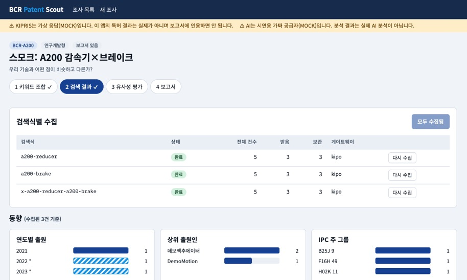

# BCR Patent Scout

BCR 제품(A100·A200·C100)의 기술 요소를 골라 KIPRIS 검색식을 만들고, 유사 특허를 모아 AI로 비교·평가한 뒤, 연구개발형·기술기획형·사업전략형 보고서 초안을 근거와 함께 내는 사내 MVP 앱입니다.
설계 기준: **BCR-PATENT-SCOUT-SPEC v1.0** (`D44 SPEC BCR IP SEARCH MVP KIPRIS.md`).

> 이 앱의 보고서는 **AI 초안**입니다. 침해·유효성·권리범위는 판단하지 않으며, 필요한 경우 변리사 검토가 필요합니다.

## 지금 상태

| 단계 | 상태 |
|---|---|
| M1 검색 (조사·키워드·검색식·수집·결과·동향) | 구현, 가상 데이터로 시험 |
| M2 유사성 (상세·AI 평가·근거 검증·매트릭스·확정) | 구현, 가짜 LLM으로 시험 |
| M3 보고서 (3유형·자동 검증·버전·다운로드) | 구현, 가짜 LLM으로 시험 |
| M4 배포 (접근 코드·한도·health) | 코드 구현. **Vercel·Neon에는 배포하지 않았음** |
| M0 Spike | **미확인** → [docs/spike.md](docs/spike.md) |

**실제 KIPRIS 호출과 실제 AI 호출은 한 번도 하지 않았습니다.** 시험은 4.4 키트의 가상 응답과 가짜 공급자로 했습니다.

## 이번 작업 요약 (2026-10-10)

기술명세서(BCR-PATENT-SCOUT-SPEC v1.0)를 바탕으로 MVP 앱을 처음부터 만들고, 가상 KIPRIS 응답과 가짜 LLM으로 전체 흐름을 시험했습니다.

**만든 것**
- React + Vite 화면 6개: 조사 목록, 새 조사, 키워드 조합, 검색 결과(동향 차트 3종·필터·핀 고정), 유사성 평가(특허 × 기술 요소 매트릭스), 보고서(미리보기·검증 경고·버전·`.md` 다운로드)
- Vercel Functions 서버 API 9개 (`api/`): 조사, 검색, 상세, 집계, 유사성 평가, 보고서 생성·관리, 접근 코드, health
- 4.4 `kipris-tool`의 클라이언트·XML 파서·집계를 `server/kipris/`로 이식
- LLM 공급자 어댑터(Anthropic · OpenAI · mock), 프롬프트 5종
- 자동 검증: 평가 근거 문장의 원문 실재 확인, 보고서의 출원번호·수치·금지 표현·머리말·초안 표시
- 접근 코드 쿠키, 하루 호출 한도, 키 마스킹, 빌드 결과물 키 검사(`npm run check:bundle`)
- 로컬은 PGlite, 배포는 Neon으로 같은 SQL(`db/migrations/001_init.sql`)
- 시험 70개 (`npm test`)와 API 전체 흐름 스모크(`scripts/smoke.mjs`)

## 오류 수정 · 개선 기록

| 문제 | 원인 | 수정 |
|---|---|---|
| 수집이 한도에서 멈추지 않았는데도 "200건에서 잘림"으로 표시됨 | `truncated`를 `전체 건수 > 받은 건수`로 계산해, 한 페이지만 받아도 잘림으로 보임 | 수집 한도(max)에 도달했고 전체 건수가 더 많을 때만 잘림으로 표시 (`shared/queries.js`의 `runSummary`, 단위 시험 추가) |
| `npm audit`에 react-router 보안 경고 2건 (보통) | `react-router-dom@6`의 알려진 취약점 | `react-router-dom@7`로 올림. 경고 0건, 빌드·시험 통과 |
| `.env.local`의 줄 끝 주석이 단순 파서(`scripts/migrate.mjs`)에서 값에 섞일 수 있음 | `KIPRIS_MOCK=1   # ...` 형태 | 주석을 별도 줄로 분리 |
| 시험 파일 구문 오류로 시험 1개 파일이 실행되지 않음 (`tests/llm.test.js`) | `vi.fn(...)` 닫는 괄호 누락 | 괄호 수정 후 70개 전부 통과 |
| 시험이 개발용 DB(`.data/`)를 건드릴 수 있음 | PGlite 저장 위치 고정 | `PGLITE_DIR=memory`로 시험은 메모리 DB 사용 |
| 실제 키가 있어도 mock이 켜져 있으면 가상 응답이 나옴 | `.env.local`이 `.env`보다 우선 | 실제 키 확인 때는 `KIPRIS_MOCK` 줄을 주석 처리, 시연 때는 켬 |

## 알려진 문제

- **실제 KIPRIS 검색은 아직 확인하지 못했습니다.** 갱신된 키로 건수 미리보기를 한 번 호출했을 때 `KIPRIS 오류 31 DEADLINE_HAS_EXPIRED_ERROR`(인증, 이용 기간 만료)가 났습니다. KIPRIS Plus 마이페이지에서 "특허·실용 검색" 서비스의 신청 상태와 이용 기간을 확인해야 합니다. 그래서 지금은 `KIPRIS_MOCK=1`(가상 응답)로 시연합니다.
- M0 Spike 8개(게이트웨이, IPC 형식, AND/OR 처리 등)는 실제 키가 통해야 확인할 수 있습니다 → [docs/spike.md](docs/spike.md)
- OpenAI 어댑터는 실제 호출을 시험하지 않았고, Neon 연결과 Vercel 배포도 하지 않았습니다.
- 가상 응답은 검색식이 달라도 같은 데모 특허 3건을 돌려줍니다. 건수와 차트는 형태 확인용입니다.

## 로컬에서 실행

Node 20.10 이상.

```bash
npm install
npm run dev          # http://localhost:5173  (프런트 + /api 를 한 프로세스로)
npm test             # vitest 70개
npm run build && npm run check:bundle   # 빌드 결과물에 키 문자열이 없는지 (AT-9)
```

`.env.local`(저장소에는 올라가지 않음)에 `KIPRIS_MOCK=1`, `LLM_PROVIDER=mock`을 두면 키 없이 전체 흐름을 볼 수 있습니다. 실제 키는 `.env`에 둡니다. 화면 위에 노란 띠로 MOCK 상태가 표시되며, **가상 결과는 보고서에 인용하면 안 됩니다.**
DB는 `DATABASE_URL`이 없으면 프로세스 안의 PGlite(`.data/pglite`)를 쓰고 처음 열 때 자동으로 마이그레이션합니다.

실제 키로 쓰려면 `.env.local`에서 mock 두 줄을 지우고 `.env.example`의 이름대로 값을 넣습니다. **키는 서버 환경변수로만 두고 `VITE_` 접두어를 절대 붙이지 않습니다.**

```bash
node scripts/smoke.mjs http://localhost:5173   # API 전체 흐름 한 번 훑기 (mock 상태의 서버에서)
```

## 구조

| 위치 | 역할 |
|---|---|
| `src/` | React 화면 (조사 목록·새 조사·키워드·결과·유사성·보고서) |
| `api/*.js` | Vercel Functions. 요청 하나 = 작업 하나 (검색식 1개, 평가 특허 5건, 보고서 1회) |
| `server/kipris/` | 4.4 `kipris-tool`에서 이식한 클라이언트·XML 파서·집계 (이름만 `.js`로, 내용 그대로) |
| `server/llm/` | 공급자 어댑터 `generate()` — anthropic · openai · mock |
| `server/prompts/` | 공통 규칙, 유사성 평가, 보고서 3종 프롬프트 |
| `server/report.js` | 머리말 조립(서버가 직접), 자동 검증 5종 |
| `server/similarity.js` | 근거 문장이 원문에 실재하는지 검증 |
| `shared/` | 브라우저와 서버가 같이 쓰는 검색식 생성 규칙·상수 |
| `data/product-features.json` | 제품 기술 요소 카탈로그 (명세 5.2) |
| `db/migrations/001_init.sql` | 스키마 (명세 6장) |

## 명세와 다르게 한 곳

| 항목 | 이유 |
|---|---|
| 보고서 머리말을 AI가 아니라 서버가 데이터로 만든다 | 검색식 표·건수·수집일을 AI가 바꾸지 못하게 하려고. AI는 본문 4절만 쓴다 |
| `GET /api/projects?id=&action=patents` 추가 | 결과 화면이 수집된 특허 목록을 읽을 곳이 명세에 없었음 |
| `PATCH /api/reports`에 `ackWarning` 추가 | 승인 전에 경고를 하나씩 "확인함"으로 처리하는 요건(명세 7.4)을 위해 |
| 기본 검색식은 키워드 **1개씩** | 한 항목에 여러 단어를 넣을 때의 AND/OR 처리를 모름(S3). 화면에서 고칠 수 있음 |
| `KIPRIS_MOCK`, `LLM_PROVIDER=mock`, 접근 코드 없는 로컬 개발 모드 | 키 없이 흐름을 시험하려고. 운영(`VERCEL_ENV=production`)에서는 접근 코드·세션 비밀이 없으면 막힘 |
| 카탈로그의 A100·C100 제품 이름 | 명세에 이름이 없어 기술 요소에서 붙임 (`BCR-A100` 소형·경량 로봇 관절용 액추에이터, `BCR-C100` 다축 로봇 제어기). 연구개발팀이 확인 |

## 수용 시나리오(13.1) 확인 상태

| # | 시나리오 | 상태 | 근거 |
|---|---|---|---|
| AT-1 | A200 · [감속기, 브레이크] → 검색식 3개 | 통과 | `tests/queries.test.js`, 화면에서 직접 확인 |
| AT-2 | 300 초과 경고 · 200건에서 멈춤 · `truncated` | 부분 | 판단·요약 함수는 단위 시험. 화면 경고는 가상 응답(5건)이라 직접 못 봄 |
| AT-3 | 핀 5건 평가 → 근거·출처 | 통과(가짜 AI) | `tests/api.test.js`. **실제 AI 품질은 미확인** |
| AT-4 | 원문에 없는 근거 → 불명 + 근거 미확인 | 통과 | `tests/similarity.test.js` |
| AT-5 | 연구개발형 보고서 | 통과(가짜 AI) | 머리말 7항목·첫 줄 표시 시험. **실제 AI 본문 품질은 미확인** |
| AT-6 | 조사에 없는 출원번호 → 경고, 승인 전 확인 | 통과 | `tests/report.test.js`, `tests/api.test.js` |
| AT-7 | `LLM_PROVIDER` 전환 | 부분 | 어댑터를 fetch 대체로 시험. 실제 OpenAI 호출은 안 해 봄 |
| AT-8 | 키 미설정 → health `not_configured`, 검색 503 | 통과 | `tests/api.test.js`. 화면의 버튼 비활성은 코드만 작성 |
| AT-9 | 번들에 키 문자열 없음 | 통과 | `npm run check:bundle` (심어 둔 누출을 잡는 것도 확인) |

## 배포 (명세 12장 요약)

1. GitHub 비공개 저장소 → Vercel에서 가져오기(Vite).
2. Vercel Marketplace에서 Neon 연결 → `DATABASE_URL`. 처음 한 번 `npm run db:migrate`.
3. 환경변수 등록(`.env.example`). `APP_ACCESS_CODE`, `APP_SESSION_SECRET`은 운영에서 필수.
4. 배포 후 `/api/health`로 DB·KIPRIS·LLM 설정을 확인하고, **먼저 [docs/spike.md](docs/spike.md)를 채웁니다.**
